<p align="center"></p>

# LabHub

Pictures, video and music in Roblox, decoded and drawn in-game, with no EditableImage and no song-specific audio uploads.

**Version 1.1.0** · what's new: [CHANGELOG.md](CHANGELOG.md)

| Part | What it does |
| --- | --- |
| **FrameLab** | Imports pictures and video from a URL and draws them with GUI objects: gradient strips, plus block pictures for big sprays and 360p video. Long videos stream to the clients that play them, at the size each device keeps up with (360p imports keep a 180p copy), and HLS addresses (`.m3u8`) play as live streams. Includes a TV tool, a Spray Paint tool, a data manager and synced playback. Every decoder is written in Luau and runs in the game. |
| **AudioLab** | Rebuilds MIDI + SoundFont music and WAV / AIFF / MP3 / AAC / Ogg Vorbis / Opus / FLAC / AC-3 sounds in-game from a small set of *generic* uploaded waveforms (sines, bundles, noise bands, textures), driven by AudioPlayers. Includes a music player. |
| **VideoLab** | Video with sound from one file: FrameLab's picture plus AudioLab's sound, on one clock. |
| **LabHub** | The package and its menu: a **Labs** button in the bottom-left corner that opens Music, Data and Settings. It also handles the owner-only settings panel (saved to a DataStore) and tool access. |

LabHub is one ModuleScript made of ModuleScripts and Folders, plus a few switched-off scripts: the templates for the parallel import workers and the client decode workers. The tools, the TV model and the audio preload list are built from Luau when the game starts.

## Install

1. Download **[`release/LabHub.rbxmx`](release/LabHub.rbxmx)** and drag it into **ReplicatedStorage** in Studio.
2. Start it on both sides with one line each:

   **ServerScriptService** → a `Script`:
   ```lua
   require(game:GetService("ReplicatedStorage"):WaitForChild("LabHub")).start()
   ```
   **StarterPlayer → StarterPlayerScripts** → a `LocalScript`:
   ```lua
   require(game:GetService("ReplicatedStorage"):WaitForChild("LabHub")).start()
   ```
3. Game Settings → Security:
   - **Allow HTTP Requests**: needed for URL imports.
   - **Enable Studio Access to API Services**: needed for saved settings and the import records, in a published place.

`start()` runs once per side; calling it again does nothing.

### What FrameLab reads

| Kind | Formats |
| --- | --- |
| Pictures | PNG, JPEG, WebP, GIF, BMP, TGA, HEIC / HEIF (iPhone photos), AVIF (with transparency) |
| Animations | GIF, WebP, APNG |
| Video | MP4 / MOV / M4V (H.264, H.265, AV1, MPEG-4 Part 2), WebM (VP9, VP8, AV1), MKV (VP9, VP8, AV1, H.264, H.265, MPEG-4 Part 2), AVI / DivX, MPEG-1 / MPEG-2 (`.mpg`, `.vob`), transport streams (`.ts`, `.m2ts`), HLS streams (`.m3u8`) |
| Sound tracks | AAC, MP3, MP2, Opus, Vorbis, FLAC, AC-3 (surround is mixed down to stereo) |

Video sources up to 1080p are shrunk to the import size as they are read.

### The tools

The **TV** and **Spray Paint** tools are built by LabHub and handed out to players according to the settings `TVToolAccess` and `SprayToolAccess`: everyone, admins, owner, list or nobody. To use a tool of your own instead, put a Tool with the same name in StarterPack.

## Settings

As the owner, open **Labs → Settings** in game. A change applies at once, and **Save** keeps it in a DataStore. The same settings are also attributes on `LabHub.FrameLab`, which you can edit in Studio's Properties panel. Their defaults are in `LabHub.Config`, where each one is described. A few to start with:

| Setting | What it does |
| --- | --- |
| `Admins`, `ToolAccessList` | People, as UserIds or usernames, comma-separated. The settings panel has a picker for these. |
| `ImportVideoQuality` | `144p` / `240p` / `360p` (240p and 360p keep a smaller copy for slower devices) |
| `VideoRendition` | Which size a client plays: `auto` (the smaller one) / `high` / `low`; a client that falls behind steps down |
| `VideoCacheMB` | Video a client keeps in memory while it plays (MB); the admins see each player's use in **Labs → Data → Clients** |
| `ImportWorkers` | Parallel workers (Actors) an MP4 / MOV import is split over in a running game |
| `VideoDecode` | Streams: `auto` (each client decodes the H.264 itself, and falls back to the server's converted copy if it falls behind) / `client` / `server` |
| `StreamMaxSourceLines`, `StreamMaxSeconds` | The tallest video the TV's Stream switch streams, and the longest HLS stream played |
| `SprayPerformanceMode` | `auto` (phones) / `on` / `off` |
| `ImageWhitelistEnabled`, `ImageWhitelist`, `ImageBlacklistEnabled`, `ImageBlacklist` | Which sites pictures may come from. |
| `LibraryDataStore` | Keep import records (URL + a 64×64 thumbnail). Off by default. |
| `Debug` | Prints, stats and the debug panels. Off by default. |
| `RampImage`, `PatternImage`, `HubIcon` | The uploaded images (see below). |

AudioLab's own attributes are on `LabHub.AudioLab`. `Manifest` picks which set of sounds is used:

| Manifest | Sounds |
| --- | --- |
| `Lean` (default) | The 72 public uploads: everything AudioLab needs. |
| `Full` | `Lean` plus any extra sounds you upload yourself (see below). |
| `Atlas` | Your own atlas: the sounds packed into a few files you upload (see below). With no atlas uploaded it plays as `Lean`. |

## Scripting

```lua
local LabHub = require(game:GetService("ReplicatedStorage"):WaitForChild("LabHub"))

-- add your own entry to the Labs menu (client)
LabHub.add({ id = "mypanel", label = "My panel", order = 10, toggle = someFrame })

-- the parts
local FrameLab = LabHub.FrameLab
local AudioLab = LabHub.AudioLab
local VideoLab = LabHub.VideoLab
```

Each part's module starts with a description of its functions.

## Uploaded assets

LabHub uses only generic assets. All of them are in this repo, with the tools that made them.

| Asset | File | Used by |
| --- | --- | --- |
| 72 core sounds | [`assets/audio/*.wav`](assets/audio) | AudioLab: all the `Lean` profile (the default) needs. Public on Roblox; the release uses them. |
| 83 extra sounds | [`assets/audio/extra/*.wav`](assets/audio/extra) | AudioLab, `Full` profile, once you upload them: decaying sines (note fades), onset bursts, pulses, all 16 noise bands, more sine bases. Plus `tex_grains2`, which textures fall back to when the bed files can't load. |
| Ramp image | [`assets/images/framelab_ramp.png`](assets/images/framelab_ramp.png) | `RampImage` |
| Pattern image | [`assets/images/FrameLabPatterns.png`](assets/images/FrameLabPatterns.png) | `PatternImage` (goes with `FrameLab/Render/PatternData`) |
| Icon | [`assets/images/labhub_icon.svg`](assets/images/labhub_icon.svg) / [`.png`](assets/images/labhub_icon.png) | `HubIcon`, the picture on the Labs button |

Every upload is mono, 16-bit, 44.1 or 48 kHz. The core sounds are each 4.16 s or shorter.

[`assets/audio/manifest.csv`](assets/audio/manifest.csv) lists every sound: its asset id (empty for the extra sounds), which profiles use it, core or extra, its file and its length. The release points at the public core uploads, so nothing needs uploading. To use your own uploads:

- **Audio:** upload the WAVs you want (core ones in place of the public copies, extra ones for `Full`), put their ids in the `asset_id` column of `assets/audio/manifest.csv`, then run `lune run tools/set_audio_ids`. It changes the ids in `AudioLab/Codec/Manifests/Files` and adds the new ones.
- **Images:** upload the PNGs as Images and set `RampImage`, `PatternImage` and `HubIcon`.

### Your own atlas

An atlas packs AudioLab's sounds into a few WAV files, so your game plays from your own uploads with only a handful of files:

```
python tools/audio/make_atlas.py                 # the Lean sounds: atlas.wav (39 s) + atlas.luau
python tools/audio/make_atlas.py --set full --max-seconds 120   # every sound, split into files of up to 2 minutes
```

1. Upload each WAV it writes (Creator Hub → Audio).
2. Paste the `.luau` it writes into `LabHub.AudioLab.Codec.Manifests.Atlas`, where the file says, and put each file's asset id in its pack's `id`.
3. Set `Manifest` to `Atlas` on `LabHub.AudioLab`, or pick it in Labs → Settings.

The texture files, `rough_880` and `pink_noise` aren't packed: every sound set plays them as their own files.

## Repository layout

```
release/LabHub.rbxmx        the release: one model file
src/LabHub/                 every module as Luau (Rojo layout); default.project.json builds it into a model
assets/audio/               the generic audio uploads: core WAVs, extra/, manifest.csv
assets/images/              the uploaded images, the icon (SVG/PNG), the pattern library (patterns/*.npy)
tools/build_release.luau    saved place -> cleaned release + src + manifest (Lune)
tools/set_audio_ids.luau    swap in your own audio asset ids (Lune)
tools/images/               makes the ramp and pattern images + PatternData (Python)
tools/audio/                makes the generic sounds (Python); see tools/audio/README.md
```

Every folder in `src/LabHub` and `assets` has a README.md describing what is in it.

## Building

The code is developed in a Studio place, and the release is built from the saved place file:

```
lune run tools/build_release "path/to/place.rbxl" --private ../private.txt
```

This takes `ReplicatedStorage.LabHub` from the place and cleans it:

- settings go back to their defaults, with no admins and no lists;
- bundled media, test modules and the debug viewer are removed;
- anything in LabHub that isn't a ModuleScript, a Folder or a switched-off script template (FrameLab's import and decode workers) stops the build;
- every text is checked against your private words file (your name, UserId, local paths…), and any match stops the build. Keep that file **outside** the repo.

It then writes `release/LabHub.rbxmx`, `src/LabHub` and `assets/audio/manifest.csv`.

To build from the sources instead: `rojo build -o LabHub.rbxmx`. Both routes make the same model.

Tools: [Lune](https://github.com/lune-org/lune) 0.10, [Rojo](https://github.com/rojo-rbx/rojo) 7.6 (optional), Python 3 with numpy, Pillow and SciPy for the asset tools.

## In Studio

`LabHub.DevKit`, from the command bar in Edit mode:

```lua
local Kit = require(game.ReplicatedStorage.LabHub.DevKit)
Kit.list()        -- bundled videos, pictures, music, sounds and banks, with sizes
Kit.check()       -- shipping checklist
```
